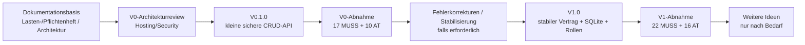

# SASD API Server – Roadmap

> **Stand:** 01.11.2026 · **Status:** Planung, keine bereits implementierten Meilensteine  
> **Verbindliche fachliche Grundlage:** [Lastenheft V0](docs/lastenheft-v0.md), [Lastenheft V1](docs/lastenheft-v1.md)  
> **Technische Konkretisierung:** [Pflichtenheft V0](docs/pflichtenheft-v0.md), [Architektur V0](docs/architektur-v0.md), [Pflichtenheft V1](docs/pflichtenheft-v1.md), [Architektur V1](docs/architektur-v1.md)  
> **Arbeitsanleitung:** [Entwicklungsplan V0](docs/entwicklungsplan-v0.md) · [Teststrategie](docs/teststrategie.md) · [Releaseprozess](docs/release-und-abnahme.md)

## 1. Produktvision

**Ein leichtgewichtiger, konfigurierbarer Open-Source-REST-API-Server für mehrere unabhängige Anwendungen.** Dieselbe Codebasis lässt sich mehrfach installieren; jede Installation erhält eine eigene URL, Datenbank, Ressourcenkonfiguration und Zugangskontrolle. Clients sprechen einheitliche HTTP/JSON-Endpunkte statt jeweils spezifischer SQL-Datenzugriffsschichten an.

Wir beginnen **nicht** mit einer universellen Plattform nach Art von DreamFactory. PHP-CRUD-API, DreamFactory und DB2Rest liefern [Ideen und Vergleichsmaterial](docs/referenzprodukte-funktionskatalog.md), aber **keine Verpflichtung**, deren gesamten Funktionsumfang nachzubauen.

Leitplanken:

1. **V0 zuerst fertigstellen und abnehmen.** V1 beginnt nicht allein aufgrund fertiggestellter Dokumentation.
2. **Sicherheit ist Teil der Basis, kein späteres Add-on.** Keine automatische Freigabe vorhandener Tabellen und keine Speicherung von API-Secrets im Webroot.
3. **Einfacher Betrieb:** PHP 8.4, MariaDB/MySQL, IONOS-kompatibles PHP-Hosting ohne Docker, Redis oder dauerhaften Prozess.
4. **Architektur vor Optimierung:** HTTP/Controller → Service → Repository-Port → Adapter; gut lesbarer, nachvollziehbar kommentierter Code.
5. **Kleine, testbare Schritte:** Jeder Slice enthält Umsetzung, negative Sicherheitsfälle, Dokumentation und messbare Abnahme.
6. **Mehrere Instanzen, ein Code:** Verschiedene URLs und Einstellungen ohne pro Anwendung gepflegte Code-Forks.

## 2. Statusmodell

Eine Roadmap ist eine Planung, keine Behauptung bereits abgeschlossener Arbeit. Insbesondere sind Lastenhefte, Pflichtenhefte und Architekturen **Entwürfe**. Wir verwenden folgende Status:

| Status | Bedeutung | Nachweis |
|---|---|---|
| **Geplant** | Umfang beschrieben, aber noch nicht begonnen | referenzierte Spezifikation |
| **In Arbeit** | Entwicklung nachweisbar gestartet | Issue/Branch/PR |
| **Zur Abnahme** | Umsetzung und Tests liegen vor | CI/Prüfprotokoll/Review |
| **Abgenommen** | alle MUSS-Gates erfüllt und dokumentiert | Abnahmeprotokoll/Release |
| **Verschoben** | bewusst nicht Teil des Release | dokumentierte Entscheidung mit neuem Ziel |

**Aktueller Stand (01.11.2026):** Grunddokumentation vorhanden; **keine durchgeführte V0- oder V1-Implementierung/Abnahme** wird behauptet. Das Repository enthält ein LICENSE; Softwarefunktionalität wird nicht allein aus den Dokumenten abgeleitet. Termine und Stundenbudgets werden erst mit belastbarer Planung ergänzt.

## 3. Gesamtübersicht

| Release / Etappe | Schwerpunkt | Status | Voraussetzung für Abschluss |
|---|---|---|---|
| D0 – Planung | Lastenhefte, Pflichtenhefte, Architektur, Roadmap, Test-/Betriebskonzept | **Dokumentation im Aufbau** | überprüfte Konsistenz und technische Entscheidungen |
| V0.1.0 | PHP + MariaDB, explizites CRUD, einfache Query, API-Key, sichere Instanzen | **Geplant** | AT-V0-01 bis AT-V0-10, 17 V0-MUSS |
| V0.1.x | Fehlerkorrekturen, Dokumentation, Sicherheitsupdates, keine Feature-Ausweitung | **Geplant** | Regressionstests, changelog/release gate |
| V1.0 | Versionierter Vertrag, SQLite, Rollen/Keys, Views/Relationen, OpenAPI, Audit, Rate Limits | **Geplant** | 22 V1-MUSS, 16 AT-V1, beide Adapter |
| Nach V1 | Weitere Backends, Benutzer-/Identitätskonzepte, komplexe Integrationen | **Nicht freigegeben** | eigenständiges Lastenheft/ADR |

**Releases sind nicht datumsgebunden.** Es werden erst dann Versionsnummern als veröffentlicht bezeichnet, wenn ein echter Tag/Release mit nachweisbar bestandener Abnahme existiert.

## 4. V0.1.0 – ausführlicher Meilensteinplan

### V0-G0 – Architektur- und Hosting-Entscheidungen

**Ziel:** Den kleinsten sicheren Deploymentpfad festlegen, bevor produktive Endpunkte entstehen.

**Arbeitspakete:** tatsächlicher PHP-/PDO-Stand des Hosts; sichere Pfade außerhalb des Document Root; verlässliche HTTPS-Erkennung und TLS-Zwang; URL-Rewrite oder Query-Fallback; DB-Credentials und API-Key als geschützte Konfiguration; dokumentierte Entscheidung zur ersten Testdatenbank, Primärschlüsseltypen und PUT/PATCH-Vertrag. Keine Sicherheitsfrage wird mit „wird später geklärt“ als produktionsfähig abgehakt.

**Ergebnisse:** kurze ADRs/Entscheidungsvermerke, geprüftes Deploymentprofil, private Verzeichnisstruktur, testbare Minimalbedingungen.

**Gate:** Nachweis, dass Konfiguration/Secrets nicht über HTTP abrufbar sind und PHP auf dem Zielhost verschlüsselte Anfragen und geschützte DB-Verbindungen korrekt behandelt. Bei Fehlschlag: keine produktive Freigabe; keine heimliche Lockerung.

### V0-M0 – Repository und Entwicklungsumgebung

**Ziel:** Saubere, reproduzierbare Basis statt sofortiger Feature-Implementierung.

**Umfang:** Composer/Autoloading nach Bedarf, PSR-konforme Namensräume, Fehler-/Codingstandards, Verzeichnisse gemäß Architektur, Beispielkonfiguration **ohne** Secrets, Git-Ignore für lokale Secrets/Logs, Testfixture und Testaufruf. Kein unnötiges DI-Framework oder ORM installieren.

**Nachweis:** PHP-Syntaxprüfung, erste Unit-Tests, sauberer Git-Status, eine dokumentierte lokale Testinstallation.

### V0-M1 – Sicherer HTTP-Kern

**Ziel:** Ein Request wird kontrolliert entgegengenommen und sicher beantwortet, bevor DB-Zugriffe freigeschaltet werden.

**Umfang:** `index.php`, Bootstrap, Router, Query-Fallback, Request-ID, HTTPS-Regel, API-Key-Authentifizierung, Body-Limit, JSON-Parser/Responder, zentraler Fehlerkatalog, Ressourcen-/Methoden-Allowlist; ein minimierter Status-Endpunkt. **Deny by default** wird in der ersten Version geprüft.

**Nachweis:** Anonymer/falscher Key, unzulässiger Pfad, Methodenumgehung, nicht unterstützter Inhaltstyp und unerwarteter Serverfehler werden reproduzierbar mit definiertem 4xx/5xx zurückgewiesen; keine Secrets im Response.

### V0-M2 – Lesende MariaDB-API

**Ziel:** Nur konfigurierte Felder und Datensätze sicher lesen.

**Umfang:** PDO-Verbindung, Ressourcen-/Felddefinition, Repository-Port, MariaDB-Adapter, `GET collection` und `GET by ID`, konsistente Einzel-/Listen-Hüllen, Typ- und Schlüsselprüfung. Keine dynamische Veröffentlichung unbekannter Tabellen.

**Nachweis:** leere Liste, vorhandene/nicht vorhandene ID, verbotene Tabelle/Spalte, SQL-Injection in Pfaden und korrekte DB-Fehlerzuordnung.

### V0-M3 – Einzelne Schreiboperationen

**Ziel:** POST, PUT, PATCH und DELETE mit dokumentierter Semantik.

**Umfang:** Pflichtfelder, unveränderliche IDs, strikter PUT-Vollersatz der klientseitig schreibbaren Repräsentation, echtes PATCH, transaktionale Einzeloperationen, Constraint-/Konfliktbehandlung, sichere Statuscodes. **Keine** Massenoperation und keine mehrstufige Business-Transaktion.

**Nachweis:** CRUD-Integrationssuite einschließlich Rollback, unverändertem Update, Foreign-Key-Konflikt, nicht erlaubten Feldern und fehlender ID.

### V0-M4 – Sichere Listenabfragen

**Ziel:** Alltägliche Listen im Client sinnvoll nutzbar machen.

**Umfang:** explizit erlaubte Gleichheitsfilter (AND), genau ein erlaubtes Sortierfeld, Offset/Limit mit verbindlichen Grenzen, stabile Default-Reihenfolge, `hasMore` ohne teure Vollzählung. Parameter werden vor SQL-Erzeugung validiert.

**Nachweis:** Filter- und Paging-Contract-Tests, Fehlertests für unbekannte Queryparameter, SQL-Injection- und Limit-Budgettests.

### V0-M5 – Betrieb und zwei unabhängige Installationen

**Ziel:** Reproduzierbares Deployment, sichere Fehlerdiagnose und Instanztrennung.

**Umfang:** JSONL-Logs ohne Secrets, öffentliche Health-/geschützte DB-Diagnose nach Review, Konfigurationsvorlage, Shared-Hosting-Anleitung, Zweitinstallation mit getrennten URL/DB/Keys/Logs, Backup-/Restore-Runbook. Keine eigene Backup-Engine.

**Nachweis:** beide Instanzen werden aus demselben Code-Commit betrieben, Schlüssel sind nicht austauschbar, Testdaten bleiben getrennt, falsche/fehlende DB-Konfiguration wird nicht als Erfolg angezeigt.

### V0-M6 – Sicherheitsreview und Abnahme

**Ziel:** Erst nach bestandenen Tests einen stabilen V0.1.0-Stand erklären.

**Umfang:** alle 17 funktionalen MUSS-Anforderungen, nichtfunktionale Mindestziele, AT-V0-01 bis AT-V0-10, Hosting-/HTTPS-/Secretpfad-Negativtests und Dokumentationsreview. Kritische Befunde werden nicht durch ein kosmetisch grünes CRUD-Demo ersetzt.

**Gate:** vollständig dokumentiertes Testprotokoll einschließlich PHP-/DB-Versionen, Hostprofil, Restore-Test, bekannten Einschränkungen; Release-Tag **erst nach** Freigabe.

### 4.1 Zuordnung zu V0-Abnahmetests

| Meilenstein | Lastenheft-Schwerpunkte | Abnahme |
|---|---|---|
| G0/M0 | RB-01 bis RB-07; V0-N01–N09 | Hosting/Private-Pfade vorbereitet |
| M1 | V0-F01, F09–F13 | AT-V0-05–07 |
| M2 | V0-F02, F06, F12 | AT-V0-02, 05 |
| M3 | V0-F03–F05 | AT-V0-03 |
| M4 | V0-F07–F08 | AT-V0-04 |
| M5 | V0-F10, F14–F16 | AT-V0-01, 08, 09 |
| M6 | V0-F17 und alle vorherigen | AT-V0-01 bis AT-V0-10 |

## 5. V1.0 – Ausbau nach erfolgreicher V0-Abnahme

Die detaillierten V1-Anforderungen stehen in [Lastenheft](docs/lastenheft-v1.md), [Pflichtenheft](docs/pflichtenheft-v1.md) und [Architektur](docs/architektur-v1.md). Die Reihenfolge richtet sich nach Abhängigkeiten, nicht nach optisch beeindruckenden Funktionen.

| Slice | Ergebnis | Mindest-Gate |
|---|---|---|
| V1-P0 | V0-Basis stabil, Vertrags- und Sicherheitstests vorhanden | alle V0-MUSS weiterhin grün |
| V1-P1 | `/api/v1`-Vertrag, Feldalias, Config-Schema V2 | kompatible API-/Migrations-Contract-Tests |
| V1-P2 | SQLite als zweiter echter Adapter, gemeinsame Typkonvertierung | CRUD-/Query-/Transaktionstests MariaDB **und** SQLite |
| V1-P3 | Filteroperatoren, begrenzte OR, Projektion, Sortierung, read-only Views | Query-/Permission-/Kostenlimits |
| V1-P4 | eine freigegebene Relationsebene, Join-/Expand-Limits | keinerlei Feld-/Count-/Relation-Leak |
| V1-P5 | mehrere technische API-Keys, Rollen und Revokation | Auth-/Policy- und Cross-Instanz-Negativtests |
| V1-P6 | Shared-Hosting-kompatibles Rate-Limit, Write-Audit und Readiness | Fail-Closed, Audit/Write im selben Commit |
| V1-P7 | OpenAPI, curl/Java/.NET-Beispiele, Config-Migration | reale Routen und Schema deckungsgleich |
| V1-P8 | vollständige Abnahme, Release-Dokumentation und Restore-Probelauf | 22 V1-MUSS + AT-V1-01–16, beide Backends |

### 5.1 Fünf SOLL-Funktionen – bewusst nicht Release-blockierend

| Kennung | Funktion | Entscheidung |
|---|---|---|
| V1-F09 | kontrollierte benannte, lesende SQL-Abfragen | nur nach konkretem Reporting-Bedarf |
| V1-F14 | serverseitig erzwungene Datensatzsicht | nur mit lückenlosen Isolationstests |
| V1-F16 | optimistic locking | nur für explizit versionierte Ressourcen |
| V1-F22 | explizit registrierte Erweiterungs-Controller | nur mit gleicher Security-Pipeline |
| V1-F27 | einfache Betriebsmetriken | ohne Verpflichtung zu Prometheus/Grafana |

Eine SOLL-Funktion wird nur bei eigener Entscheidung zum verbindlichen Releaseumfang. Ihre Verschiebung ist im Releasebericht ausdrücklich anzugeben.

## 6. Spätere Optionen – ohne Entwicklungszusage

Die [Referenzstudie](docs/referenzprodukte-funktionskatalog.md) nennt deutlich mehr Funktionen als V0/V1 benötigen. Themen für **eigene künftige Entscheidungen**, nicht Teil dieser Roadmap als feste Releases:

- PostgreSQL und weitere Datenadapter; ggf. ein separates JSON-Datei-Backend mit geklärter Atomarität/Locking.
- Fachlich spezifische API-Services, wenn einfache CRUD-Freigaben nicht ausreichen.
- Benutzeridentitäten und OAuth/OIDC, wenn öffentliche Endnutzer-Clients erforderlich werden.
- Mandantenfähigkeit, datenbankübergreifende Queries und komplexere Transaktionen.
- Operator-UI, Import/Export, Datenanalyse, spezielle GIS-/Integrationsdienste.

**Expliziter Verzicht:** JBoss-/WebLogic-Nachbau, freie Client-SQL-Schnittstelle, HTTP-Schemaänderungen und Übernahme einer vollständigen DreamFactory-Featureliste.

## 7. Arbeitsweise, Issues, Pull Requests und Release-Kriterien

Jeder Arbeitsschritt wird als **kleines GitHub-Issue oder Milestone-Item** beschrieben, beispielsweise mit `V0-M2` und referenzierten Anforderungscodes. Ein Issue umfasst Ziel, nicht enthaltenen Umfang, relevante Lastenheft-/Pflichtenheft-Abschnitte, Sicherheitstests, konkrete Fertigstellungsprüfung und Dokumentationsfolgen. Erst nach bestandenen Tests erfolgt ein PR/Commit auf `main`.

### 7.1 Definition of Ready

- Anforderung und Akzeptanz eindeutig und widerspruchsfrei referenziert.
- Hosting-/Sicherheitsfrage geklärt, wenn der Slice davon abhängt.
- Kleiner Umfang mit klarer Verantwortlichkeit und ohne unbeabsichtigte V1-Ausweitung.
- Nachweisbare positive und negative Tests beschrieben.
- Bei öffentlichem API-Vertragswechsel: ADR und Contract-Test vorgesehen.

### 7.2 Definition of Done

- Anwendungscode lesbar, geschichtet, wichtige Entscheidungen nachvollziehbar kommentiert.
- Unit-, Integrations-, Security- und Contract-Tests für geänderte Pfade vorhanden.
- Keine Secrets, Client-PII oder produktive DB-Daten in Repository/Testartefakten/Logs.
- CI und manueller, falls notwendig, Hosting-Test erfolgreich.
- API-/Konfigurations-/Betriebsdokumentation aktualisiert; Changelog-Eintrag bei nutzerrelevanter Änderung.
- Sicherheitsgrenzen bleiben nachweisbar; keine offenen kritischen Findings.

### 7.3 Release Gate

Ein GitHub-Tag/Release wird **nicht** vor vollständiger, belegter Abnahme gesetzt. Vorgehen und Checkliste: [Release und Abnahme](docs/release-und-abnahme.md). Ein bereits dokumentierter Meilenstein gilt **nicht** automatisch als implementiert.

## 8. Abhängigkeiten, Risiken und Entscheidungspunkte

| Risiko/Abhängigkeit | Konkrete Gegenmaßnahme | Sperrt |
|---|---|---|
| Keine nachweisbar privaten Dateien auf Shared Hosting | Deployment isolieren oder Hostprofil ändern; keine Produktivfreigabe | V0-G0 |
| TLS-Erkennung vertraut manipulierten Proxy-Headern | HTTPS-Policy/Providerkonfiguration verifizieren | V0-M1 |
| API-Key in öffentlichem Client | vertrauenswürdigen Backend-Proxy verwenden oder Scope erweitern | produktiver Endkundenzugang |
| automatische DB-Tabellenfreigabe | verpflichtende Allowlist + Negativtests | alle Datenendpunkte |
| Filter/SQL-Injection | typisierte Queryparameter/SQL-Bindings | V0-M2/M4, V1-P3 |
| SQLite Busy/Locking und Journaling | SQLite auf Zielhost parallel testen | V1-P2 |
| Audit-Write schlägt fehl | Datenänderung im selben DB-Transaktionsrahmen rollbacken | V1-P6 |
| Rate-Limit-Store nicht atomar | fail-closed / anderer geprüfter Store | V1-P6 |
| V0→V1 bricht Clients | getrennte API-Pfade, Contract- und Migrations-Tests | V1-P8 |

Vollständige Einzelverfolgung: [Risikoregister](docs/risikoregister.md) sowie [Architekturentscheidungen](docs/adr/README.md).

## 9. Dokumenten- und Statuspflege

Für jeden Meilenstein gehört der aktuelle Status in GitHub-Issues/Milestones, nicht durch frei erfundene Prozentzahlen in diese Roadmap. Die Tabelle wird bei tatsächlich vollzogenen Gates aktualisiert. Entscheidungen mit längerfristiger Wirkung erhalten ein ADR; neue fachliche Anforderungen erfordern eine bewusste Änderung am Lastenheft. Kein technisches Dokument behauptet eine Abnahme ohne Testprotokoll.

**Nächster konkreter Schritt:** **V0-G0** – verifizierte, sichere Zielhosting-Grenzen und minimales Konfigurations-/API-Vertragsreview. Erst danach Repository-Slice M0 und Implementierung.

---
**Hinweis:** Alle in dieser Roadmap genannten Versionen und Tests sind Ziele, soweit nicht anhand von GitHub-Tags, Testprotokollen oder eindeutig freigegebenen Entscheidungen etwas anderes nachgewiesen ist.
